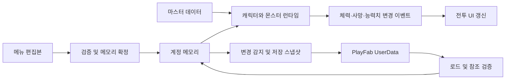

# Knight Squad RPG

> **공개용 리소스 안내:** 이 저장소에는 외부 에셋 원본을 제외하고,
> 직접 제작한 공개용 코드와 리소스만 포함되어 있습니다.
>
> **[게임 실행용 빌드 다운로드](https://github.com/heyj97/KnightSquad-Public/releases/download/1.0.1/Build.zip)**

Unity 2D URP로 제작 중인 **PC 파티 RPG 포트폴리오 프로젝트**입니다. 최대 네 명의 파티가 필드를 자동으로 전투하며, 플레이어는 캐릭터 선택과 스킬 사용, 파티 편성·성장·장비 관리를 맡습니다. 레이드에서는 보스 전투와 직접 조작하는 패턴 미니게임을 함께 진행합니다.

## 게임 스크린샷


## 주요 기능

| 영역 | 현재 구현 |
|---|---|
| 필드 전투 | 4인 파티 자동 전투, 일반·엘리트·보스 웨이브, 스테이지 이동, 챕터 정산·재도전 |
| 선택과 스킬 | 아군·몬스터 호버/선택, 숫자키 스킬 입력, 공격·버프 대상 지정, 쿨타임·버프 표시 |
| 파티 관리 | 네 고정 슬롯 편성, 캐릭터 이동·해제, 변경 슬롯 초기화와 실패 시 복구 |
| 성장 | 중복 캐릭터 자동 레벨업, 레벨에 따른 능력치 성장, 여섯 종류의 파티 강화, 고정 전투력 |
| 장비·인벤토리 | 무기·방어구·장신구 장착/해제·캐릭터 간 이전, 편집 후 일괄 적용, 장비 판매 |
| 캐릭터 뽑기 | 골드 1회/10회, 일일 제한, 선택 천장, 획득 결과, 만렙 중복의 별의 조각 전환 |
| 레이드 | 입장 조건·보스 미리보기, 180초 보스전, 세 가지 패턴 미니게임, 결과·보상·재도전·필드 복귀 |
| 계정·저장 | PlayFab 회원가입/로그인, 영역별 온라인 저장, 실패 재시도, 필드 체크포인트, 오프라인 골드 |
| 공통 UI | 메뉴 일시정지, 메시지박스 키보드 응답, 씬 페이드, 저장 후 종료 |

### 현재 콘텐츠

현재 등록된 마스터 데이터와 진행 상수 기준입니다. 제작 예정 수량과는 구분합니다.

| 구분 | 등록 범위 |
|---|---|
| 필드 | 3챕터, 챕터당 10스테이지 |
| 캐릭터 | 5종 |
| 몬스터 | 5종: 일반 2·엘리트 1·스테이지 보스 1·레이드 보스 1 |
| 장비 | 3종 |
| 스킬 | 7종 |
| 레이드 선택 | 보스 1종 |

## 개발 환경

| 항목 | 프로젝트 기준 |
|---|---|
| Unity Editor | **6000.0.70f1** |
| 렌더링 | Universal RP **17.0.4**, 2D |
| UI | UGUI **2.0.0**, `UnityEngine.UI` |
| 입력 | Input System **1.19.0** 설치, 기존 `UnityEngine.Input` 사용, Active Input Handling은 **Both** |
| 캐릭터 모델·애니메이션 | SPUM, Animator |
| 계정·온라인 데이터 | 프로젝트에 포함된 PlayFab SDK |
| 기본 화면 크기 | 1280 × 720 |
| 별도 검증 도구 | .NET 8 SDK: `Server/Client.Tests` 실행용 |

Unity 버전은 [ProjectVersion.txt](ProjectSettings/ProjectVersion.txt), 패키지는 [manifest.json](Packages/manifest.json)과 [packages-lock.json](Packages/packages-lock.json)을 기준으로 합니다.

## 기술소개서

Knight Squad RPG의 기술 구현은 **전투 상태의 일관성, 편집 데이터의 검증과 복원, 비동기 저장 실패 처리, 직접 조작하는 레이드 패턴**을 중심으로 구성했습니다. 자동 전투와 성장·장비·수집 기능이 같은 데이터를 공유하므로, 기능 사이의 상태 전달과 확정 시점을 주요 설계 과제로 다룹니다.

Unity·URP·UGUI를 기반으로 PlayFab SDK와 SPUM을 사용하며, 아래에서는 프로젝트의 게임 코드와 에디터 도구가 각 과제를 처리하는 방식을 설명합니다. 확인 기준은 위 README와 동일한 현재 작업 트리입니다.

### 1. 데이터의 역할과 수명 분리

같은 캐릭터라도 기본 설정, 계정의 보유 상태, 현재 전투 상태는 서로 다른 수명을 갖습니다. 이를 다음과 같이 나누어 관리합니다.

| 구분 | 주요 구성 | 관리하는 데이터 |
|---|---|---|
| 마스터 | `CharacterData`, `MonsterData`, `EquipmentData`, `SkillData`, `MasterDataMgr` | 기본 능력치·모델·아이콘·스킬 정의 |
| 계정 메모리 | `GlobalValue`, `CharData`, `ItemData`, 저장 DTO | 재화·보유·레벨·장착 UID·편성·진행 |
| 전투 런타임 | `CharacterBase`, `MonsterBase`, `PartyStat` | 현재 HP·생존·타겟·버프·쿨타임·성장 보정 |
| 화면·편집 | UI 매니저, 편성·장비 편집 세션 | 표시 상태·미확정 변경·사용자 입력 |
| 영속화 | `PlayerDataMgr` | 영역별 변경 감지·검증·압축·전송·재시도 |



캐릭터 레벨 성장은 `CharacterGrowthCalc`가 담당하고 전투·상세보기·고정 전투력에서 함께 사용합니다. 고정 전투력은 레벨 적용 기본값·장비·파티 성장으로 다시 구성하여 임시 버프와 현재 체력의 영향을 제외합니다. 전투력 변경 이벤트는 합계가 달라졌을 때 전달하고, UI는 연결 시 현재 값도 즉시 표시합니다.

관련 코드: [CharacterGrowthCalc.cs](Assets/_Project/02.Scripts/Classes/System/Managers/CharacterGrowthCalc.cs), [PartyAtkCalc.cs](Assets/_Project/02.Scripts/Classes/Party/PartyAtkCalc.cs), [GlobalValue.cs](Assets/_Project/02.Scripts/Classes/System/GlobalValue.cs).

### 2. 전투 상태와 씬 전환의 실행 순서 관리

`BattleFlowMgr`는 `Preparing`, `Fighting`, `Transitioning`, `Failed`, `Defeated`, `Cleared`, `BossDefeated` 상태와 `Field`·`Raid` 모드를 관리합니다. `CanRunCombat`에 전투 상태, 메뉴 정지, 저장 장애, 씬 전환, 레이드 패턴 정지 조건을 모아 공격·스킬 실행의 공통 기준으로 사용합니다.

필드와 레이드는 UI·게임 로직 씬을 유지한 채 맵 씬을 Additive로 교체합니다. 중복 전환·빌드 미등록 씬을 먼저 검사하고, 새 맵의 로드 성공을 확인한 뒤 기존 맵을 해제합니다. 전환 요청 수락과 실제 완료 결과도 구분합니다. 모드 변경에는 파티 상태 초기화가 포함되므로 맵 전환 전체가 기존 체력·버프까지 복원하는 작업은 아닙니다.

공통 페이드는 `DontDestroyOnLoad`로 유지되는 `SceneFadeRunner`가 실행합니다. 타이틀 씬이 해제된 뒤에도 전환 코루틴을 이어가며, 중첩된 코루틴의 예외를 처리하고 `finally`에서 화면과 입력 잠금을 정리합니다. 페이드는 실제 시간 기준으로 진행하여 메뉴의 시간 정지와 함께 사용할 수 있습니다.

관련 코드: [BattleFlowMgr.cs](Assets/_Project/02.Scripts/Classes/System/Managers/BattleFlowMgr.cs)의 `CanRunCombat`, `TrySwitchMap`, `SwitchMap`; [SceneFadeRunner.cs](Assets/_Project/02.Scripts/Classes/System/Managers/SceneFadeRunner.cs)의 `Execute`, `Fade`.

### 3. 공통 타겟 계약과 프레임 단위 입력 충돌 방지

아군과 몬스터의 선택은 `ITargetable`, 피해 처리는 `IDamageable`, 기본 공격은 `IAttackable` 등의 인터페이스로 연결합니다. 선택 매니저는 타겟 가능 여부와 비활성 이벤트를 공통 처리하여 사망 즉시 호버·선택을 해제합니다.

숫자키와 클릭은 상황에 따라 캐릭터 선택·스킬 선택·스킬 대상 지정으로 의미가 달라집니다. 같은 입력이 한 프레임에 두 동작으로 이어지는 문제는 입력을 사용한 프레임과 선택 상태를 기록해 처리합니다.

- `SkillPanelMgr`는 캐릭터가 선택된 프레임을 기록하고 해당 프레임의 스킬 실행을 건너뜁니다.
- `CharacterBase.BlocksNormalTargetSelection`은 스킬 대상 선택 중과 종료한 프레임까지 일반 선택을 막아 시전자 선택을 유지합니다.
- `MessageBoxMgr`는 열린 프레임과 응답 프레임을 구분하고, 기존 메시지를 정리한 뒤 콜백을 실행하여 새 메시지가 같은 키로 닫히지 않게 합니다.

이 처리는 해당 상태를 확인하는 입력 경로에 적용됩니다. 메뉴·씬 전환·저장 진행 제한은 각 입력 진입점에서도 검사합니다.

관련 코드: [TargetSelMgr.cs](Assets/_Project/02.Scripts/Classes/System/Managers/TargetSelMgr.cs), [SkillPanelMgr.cs](Assets/_Project/02.Scripts/Classes/System/Managers/UI/SkillPanelMgr.cs), [CharacterBase.cs](Assets/_Project/02.Scripts/Classes/Characters/Master/CharacterBase.cs), [MessageBoxMgr.cs](Assets/_Project/02.Scripts/Classes/System/Managers/UI/Panels/MessageBoxMgr.cs).

### 4. 편집본 검증과 런타임 적용 실패 복원

파티·장비·강화는 화면에서 편집하는 동안 확정 데이터와 편집본을 따로 유지합니다. 적용 시점에 조건을 다시 검사하여 편집 도중 달라진 상태와 부분 적용 실패를 처리합니다.

| 기능 | 확정 전 검사 | 적용과 복원 방식 |
|---|---|---|
| 파티 편성 | 네 슬롯, ID 중복, 보유·마스터 데이터, 모델 참조, 최소 한 명 편성 | 변경 슬롯의 모델과 캐릭터 상태를 보관하고 생성·초기화 실패 시 복원. 같은 슬롯의 같은 캐릭터는 교체 생략 |
| 장비·판매 | 원본 장착 상태 일치, UID 소유·중복·부위, 판매 조건·가격, 골드 범위 | 장착 이전·해제·판매 예약을 함께 검증하고 런타임 적용 실패 시 스냅샷 복원 |
| 파티 강화 | 원본 레벨 일치, 목표 상한, 단계별 누적 비용, 골드, 다른 변경 작업 여부 | 골드와 여섯 성장값을 함께 확정한 뒤 변경 통지 |

파티 모델 교체에서는 기존 모델을 분리 보관하고 `CharacterBase.PartySnapshot`에 HP·버프·쿨타임 등을 복사합니다. 모든 변경 슬롯의 초기화가 성공하면 이전 모델을 정리하고, 실패하면 `finally`에서 복원합니다. 이 복원의 범위는 모델 교체·캐릭터 초기화 단계이며 이후의 모든 이벤트 구독자나 원격 저장까지 포함하지는 않습니다.

화면 수명과 편집 세션 수명도 구분합니다. 도감에서 상세보기로 이동할 때는 편성 편집본을 일시 보관하고 돌아오면 이어서 사용합니다. 도감 메뉴 자체를 종료하면 편집을 끝내고 다음 진입 시 확정 편성에서 다시 시작합니다.

관련 코드: [PartyMgr.cs](Assets/_Project/02.Scripts/Classes/Party/PartyMgr.cs)의 `TrySpawnCharacterModel`, `TryApplyPartyUpgradePlan`; [CharacterRootMgr.cs](Assets/_Project/02.Scripts/Classes/System/Managers/UI/CharacterRootMgr.cs)의 스냅샷 처리; [EquipmentMgr.cs](Assets/_Project/02.Scripts/Classes/System/Managers/EquipmentMgr.cs)의 `EquipmentEditSession`, `TryApply`; [CollectionPanelMgr.cs](Assets/_Project/02.Scripts/Classes/System/Managers/UI/Panels/CollectionPanelMgr.cs)의 `CollectionPartyEditSession`.

### 5. 뽑기 결과 계산·확정·저장 분리

뽑기는 확률, 일일 제한, 선택 천장, 중복 성장, 재화 차감이 함께 바뀌는 기능입니다. 계산 중 원본 데이터가 일부 변경되지 않도록 `CharacterGachaEngine.TryCreatePlan()`이 보유 상태를 복사한 뒤 결과 계획을 만듭니다. 시각과 난수 함수를 인자로 받아 특정 날짜·천장 경계·추첨 결과를 반복 재현할 수 있습니다.

```text
입력과 보유 상태 검증
  → 복사본에서 비용·추첨·중복 성장·천장·별의 조각 계산
  → GlobalValue.ApplyGachaState로 메모리 확정
  → CharacterInfo와 PlayerInfo 저장 완료 대기
  → Applied와 Saved를 구분하여 결과 전달
```

저장 실패 후에는 이미 확정한 결과를 유지하고 고정된 저장 스냅샷을 재시도합니다. 다음 뽑기는 미해결 저장 상태를 확인하여 제한하므로 같은 요청의 비용을 다시 차감하거나 결과를 재추첨하지 않습니다. 실제 추첨과 재화 계산은 클라이언트에서 수행합니다.

관련 코드: [CharacterGachaEngine.cs](Assets/_Project/02.Scripts/Classes/System/Managers/CharacterGachaEngine.cs)의 `TryCreatePlan`; [CharacterGachaMgr.cs](Assets/_Project/02.Scripts/Classes/System/Managers/CharacterGachaMgr.cs)의 `DrawAsync`, `CharacterGachaOperation`.

### 6. 영역별 비동기 저장과 고정 스냅샷 재시도

여러 게임 기능에서 발생하는 저장 요청은 `PlayerDataMgr`가 영역 플래그로 합산합니다. 진행 중인 저장 Task를 공유하고 하나의 저장 루프에서 요청을 순서대로 보내 같은 클라이언트의 API 전송이 겹치지 않게 합니다. 전송 중 발생한 일반 변경과 새 명시 저장 요청의 후속 처리도 구분합니다.

부분 저장 전에는 기존 저장 기준값과 현재 변경을 합쳐 예상 복원 상태를 검증합니다. 캐릭터의 장착 UID가 아직 저장하지 않은 인벤토리를 참조하는 경우 필요한 변경 영역을 함께 포함합니다. 성공한 전송 영역만 기준 스냅샷을 갱신하여 미전송 변경을 저장 완료로 처리하지 않습니다.

실패 요청은 영역·JSON·압축 전송값을 고정하고 재시도 대기와 SDK의 `RetryAfterSeconds`를 반영합니다. 재시도 중 발생한 새로운 변경은 기존 실패 스냅샷에 섞지 않고 후속 저장으로 남깁니다. 정상 종료 경로에서는 진행을 멈춘 뒤 마지막 변경까지 저장 완료를 기다립니다.

이 구조는 실행 중인 클라이언트의 요청과 데이터 정합성을 관리합니다. PlayFab UserData의 여러 키에 대한 트랜잭션이나 다른 기기까지 포함한 조건부 쓰기를 제공하지는 않습니다.

관련 코드: [PlayerDataMgr.cs](Assets/_Project/02.Scripts/Classes/System/Managers/PlayerDataMgr.cs)의 `RequestSave`, `StartSaveLoop`, `SaveLoopAsync`, `GetChangedTypes`, `SaveAndQuit`; [Server/README.md](Server/README.md).

### 7. 필드 체크포인트와 보상 처리 기록

재접속 시 전투를 새로 구성하면서 이전 보상을 다시 지급하지 않도록, 현재 도전 ID와 스테이지·고정 몬스터 슬롯별 보상 처리 기록을 보관합니다. 드롭 실패나 가방 부족도 처리 완료로 남겨 같은 슬롯의 재추첨을 막습니다. 실제 획득한 아이템은 별도 사본으로 유지하여 이후 판매 여부와 관계없이 보상창에 표시합니다.

진행 중인 스테이지는 진입 체력으로 복원하고, 클리어·패배 상태는 종료 시 체력과 상태를 복원합니다. 진행 중 HP 변동과 진입 체크포인트를 구분하여 재생성된 전투의 시작 조건을 유지합니다. 재도전은 새로운 도전 ID로 처리 기록을 초기화합니다.

중복 방지는 현재 도전과 복원된 저장본을 기준으로 합니다. 매 처치마다 즉시 서버에 기록하는 구조가 아니므로 서버 저장 전 강제 종료까지 포함한 지급 완료 보장은 별도의 과제입니다.

관련 코드: [StageMgr.cs](Assets/_Project/02.Scripts/Classes/System/Managers/StageMgr.cs)의 `GrantFieldReward`, `CaptureEntryHp`, `RestoreEntryHp`; [DataFormats.cs](Assets/_Project/02.Scripts/Classes/System/DataFormats.cs)의 `ChapterRunSaveData.TryRecordReward`.

### 8. 레이드 패턴의 순서·경로·공간 판정

`RaidPatternMgr`는 세 패턴의 순서를 섞고 보스 HP 구간과 마지막 처리 구간을 비교하여 중복 실행을 막습니다. 큰 피해로 여러 구간을 한 번에 넘으면 현재 도달한 구간의 패턴을 예약하며 건너뛴 상위 구간은 소급 실행하지 않습니다. 따라서 한 전투에서 항상 세 패턴이 모두 실행되는 것은 아닙니다.

패턴 완료 이벤트에서는 결과를 보류하고 `BattleFlowMgr.LateUpdate()`에서 **패턴 결과 적용 → 전체 제한시간 만료 판정 → 다음 패턴 진행** 순서로 처리합니다. 패턴 중 일반 전투와 전투 모델 애니메이션은 멈추지만 전체 레이드 제한시간은 계속 흐릅니다.

| 기술 과제 | 현재 구현 |
|---|---|
| 도달 가능한 무작위 경로 | 5×5 보드에서 오른쪽 4회·위쪽 4회의 순서를 섞어 시작점과 도착점이 연결되는 9칸의 안전 경로 구성 |
| 이동 중 위험 칸 누락 방지 | 셀 크기로 정규화한 이동 선분이 통과하는 격자를 순회하고, 대각선 모서리에 닿는 양옆 칸도 검사. 위험 판정 시 이동을 중단하고 마지막 안전 위치로 복귀 |
| 폭발 경고와 피해 판정 일치 | 같은 반지름을 경고·폭발 표시·거리 판정에 사용하고 기존 폭발 및 같은 묶음 후보와 겹치는 배치 제외. 생성 시도 횟수에 상한 적용 |

타일 판정은 캐릭터의 이동 선분을 기준으로 합니다. 폭발 배치는 공간이 부족하면 요청한 수보다 적게 생성될 수 있습니다.

관련 코드: [RaidPatternMgr.cs](Assets/_Project/02.Scripts/Classes/System/Managers/RaidPatternMgr.cs), [RaidTilePatternMgr.cs](Assets/_Project/02.Scripts/Classes/System/Managers/RaidTilePatternMgr.cs)의 `GenerateSafePath`, `ResolveMovement`; [RaidTilePathUtility.cs](Assets/_Project/02.Scripts/Classes/System/Managers/RaidTilePathUtility.cs)의 `VisitCells`; [RaidExplosionLayout.cs](Assets/_Project/02.Scripts/Classes/System/Managers/RaidExplosionLayout.cs)의 `Generate`.

### 9. 객체 재사용과 콘텐츠 제작 도구

반복 생성되는 전투 표시와 웨이브 구성에는 용도별 재사용 정책을 적용합니다.

| 대상 | 재사용·과부하 처리 |
|---|---|
| 일반·치명타 공격 이펙트 | 비활성 인스턴스 재사용, 부족하면 설정 수만큼 확장, 재생 종료 시 비활성화 |
| 피해·회복 텍스트 | 풀 재사용과 최대 개수 제한, 상한 도달 시 추가 표시 생략 |
| 시스템 메시지 | 표시 상한에서 가장 오래된 메시지 재사용, 짧은 간격의 동일 메시지 억제 |
| 몬스터 웨이브 | 고정 전투 루트 재사용, 생존자 집합과 사망 이벤트 관리. 모델은 웨이브 구성 시 생성·제거 |

콘텐츠 제작에는 캐릭터·몬스터·장비·스킬 전용 에디터 창을 사용합니다. 공통 저장 도구가 ID와 기존 에셋 경로 충돌을 검사하고, 마스터 자동 등록 도구가 빈 ID·중복 ID를 제외하여 기존 데이터에 신규 항목을 추가합니다. 밸런스 기준은 로컬 코드에 정의되어 있습니다.

재사용 구조의 도입은 코드로 확인되지만 프레임 시간·GC 할당량·메모리 절감 수치는 별도 프로파일링이 필요합니다.

관련 코드: [AtkFxPoolMgr.cs](Assets/_Project/02.Scripts/Classes/System/Managers/AtkFxPoolMgr.cs), [TextPoolMgr.cs](Assets/_Project/02.Scripts/Classes/System/Managers/TextPoolMgr.cs), [MonsterPoolMgr.cs](Assets/_Project/02.Scripts/Classes/System/Managers/MonsterPoolMgr.cs), [DataMakerUtility.cs](Assets/Editor/DataMakerUtility.cs), [MasterDataMgrEditor.cs](Assets/Editor/MasterDataMgrEditor.cs).

### 10. 검증 설계와 현재 기술 범위

`Server/Client.Tests`는 실제 게임 소스 일부를 링크하고 Unity·PlayFab SDK를 대역으로 바꾸어 저장 장애와 경계 조건을 재현합니다. 계산 코드를 복제한 테스트 전용 구현을 별도로 두지 않고 같은 소스의 동작을 검사하는 구성입니다.

| 검사 영역 | 코드에 포함된 주요 사례 |
|---|---|
| 저장 | 요청 합산·영역별 기준 갱신·고정 스냅샷 재시도·응답 유실·이관·종료 대기 |
| 필드 진행 | 진입 HP·보상 처리 기록·다음 스테이지·종료 상태·재도전 |
| 뽑기·성장 | 천장 경계·일일 제한·중복 자동 성장·전투력·저장 실패 후 결과 유지·재로그인 복원 |

관련 코드: [Client.Tests.csproj](Server/Client.Tests/Client.Tests.csproj), [Program.cs](Server/Client.Tests/Program.cs), [GachaChecks.cs](Server/Client.Tests/GachaChecks.cs).

현재 설계에서 추가 검증 또는 확장이 필요한 범위는 다음과 같습니다.

- Unity 씬·Inspector·Animator·UI 연결, 실제 PlayFab 응답과 배포 빌드 동작은 실행 환경에서 확인해야 합니다. 이 기술소개서 작성 과정에서는 테스트·빌드를 새로 실행하지 않았습니다.
- 클라이언트가 추첨·재화·보상을 계산하고 UserData에 직접 기록합니다. 서버 권한 기반의 게임 규칙 검증과 여러 기기 동시 편집 제어는 향후 확장 영역입니다.
- 저장 재시도와 편집 스냅샷은 실행 중 메모리에 유지됩니다. 강제 종료 후 미저장 데이터나 편집본을 복구하는 로컬 영속화는 구현되어 있지 않습니다.
- 성능 효과의 정량 평가는 실제 PC 빌드에서 Profiler 측정이 필요합니다.
